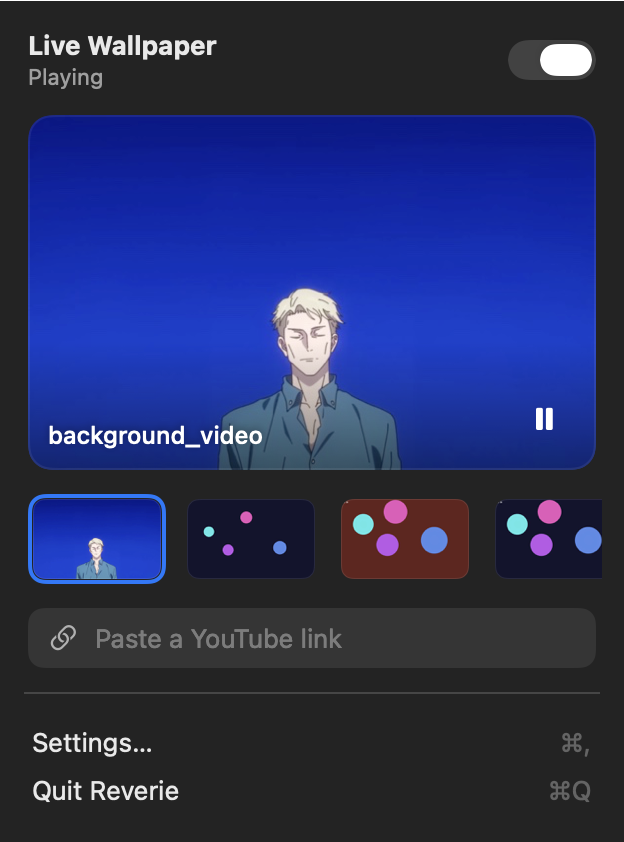
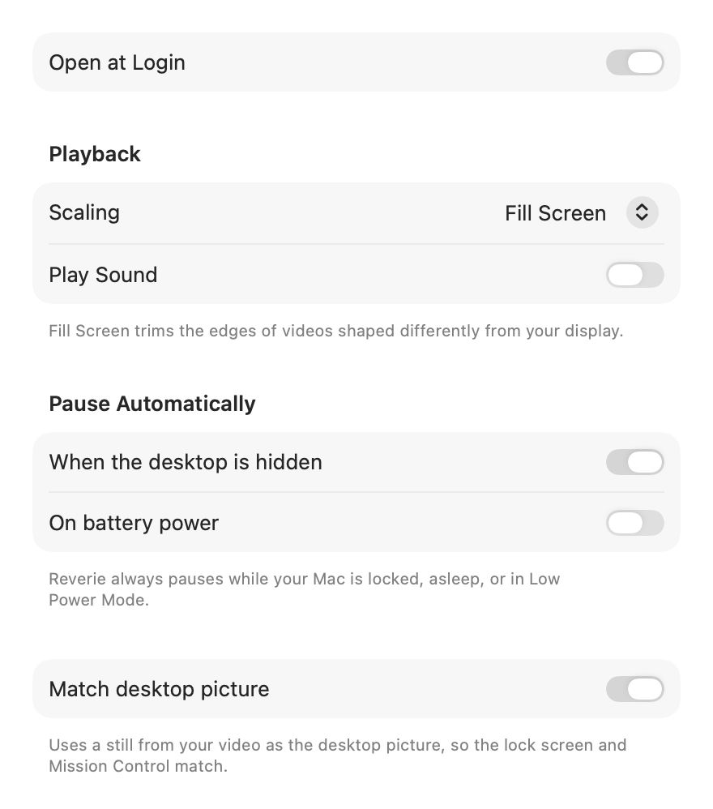

<p align="center">
  
</p>

<h1 align="center">Reverie</h1>

<p align="center">Live video wallpapers for macOS and Linux — a native menu bar app on the Mac, a GTK app with a GNOME Shell extension on Linux. Inspired by <a href="https://github.com/jeffshee/gnome-ext-hanabi">Hanabi</a> for GNOME.</p>

<p align="center">
  
  &nbsp;
  
</p>

## Features

- **Any MP4 or MOV as your wallpaper** — plays beneath your desktop icons, on every Space and every display, and never intercepts clicks.
- **YouTube links** — paste a link and Reverie downloads a silent, hardware-friendly copy using [yt-dlp](https://github.com/yt-dlp/yt-dlp), installed on demand the first time you ask.
- **Smart pausing** — keeps playing while any part of the wallpaper is visible (even through the translucent menu bar and Dock), and pauses when it's fully hidden by a full-screen app, while locked or asleep, in Low Power Mode, and optionally on battery.
- **Fill or Fit** — Fit shows the whole video and extends it to the screen edges with a soft blur instead of black bars.
- **Matching lock screen** — sets a still from your video as the real desktop picture, so the lock screen and Mission Control match. Your original picture comes back when you turn Reverie off.
- **Small and quiet** — one shared hardware decoder for all displays. On an M2: ~0% CPU paused, ~1% for 1080p, ~2% for 4K60, 40–90 MB of memory.
- Crossfades between videos, recent-videos strip, drag and drop, Open With → Reverie, Open at Login, light and dark mode.

<p align="center">
  
</p>

## Requirements (macOS)

- macOS 27 or later, Apple silicon
- To build: Xcode **or** just the Command Line Tools (`xcode-select --install`)

## Build and install (macOS)

```bash
git clone https://github.com/austxu/Reverie.git
cd Reverie
./build.sh --install
```

This builds `build/Reverie.app` (ad-hoc signed), copies it to `/Applications`, and launches it. Use `./build.sh` alone to build without installing.

## Usage (macOS)

1. Click the Reverie icon in the menu bar.
2. Click **+** (or **Choose a Video**), drag a video onto the menu, or right-click a file in Finder → **Open With → Reverie**. You can also paste a YouTube link.
3. Click a thumbnail to switch videos; right-click one to show it in Finder or remove it.
4. **Settings…** has scaling, sound, automatic pausing, desktop-picture matching, and Open at Login.

From the terminal: `open -a Reverie path/to/video.mov`.

**Tip:** for a perfect fit in either mode, use a video with the same shape as your display (e.g. 2560×1600 for a 16:10 MacBook) encoded as H.264 or HEVC. WebM isn't supported.

## How it works (macOS)

Reverie places a borderless, click-through window at the desktop window level on each screen — above the system wallpaper, below Finder's icons — and plays the video there with `AVPlayerLayer`. A single `AVQueuePlayer` + `AVPlayerLooper` feeds every screen, so the video is decoded once. Visibility comes from the window server's occlusion state.

| File | Role |
|---|---|
| `Sources/Reverie/WallpaperEngine.swift` | Desktop-level windows, shared looping player, crossfades |
| `Sources/Reverie/PauseMonitor.swift` | Lock, sleep, power, and visibility → pause reasons |
| `Sources/Reverie/AppModel.swift` | App state, settings, library, desktop picture sync |
| `Sources/Reverie/YouTubeDownloader.swift` | On-demand yt-dlp install and downloads |
| `Sources/Reverie/MenuView.swift`, `SettingsView.swift` | SwiftUI interface |
| `tools/make_icon.swift`, `tools/make_test_video.swift` | Icon and sample-video generators |

## Linux

The Linux version lives in [`linux/`](linux): a GTK 4 / libadwaita app with the same controls as the Mac menu (switch, preview, recent videos, YouTube links, settings), plus a GNOME Shell extension that puts the video under your desktop. It plays with libmpv, decoding once with VA-API for every monitor and handing frames to GTK as GPU textures, so 1080p30 costs about as much CPU as plain `mpv`.

**Desktops:** GNOME 46–50 on Wayland (tested on 50) through the bundled Shell extension. wlroots compositors (Sway, Hyprland, river, Wayfire, niri, labwc…) through [gtk4-layer-shell](https://github.com/wmww/gtk4-layer-shell). On KDE Plasma the desktop shell draws its own background layer, so use a Plasma wallpaper plugin there instead.

**Requirements:** Python 3.10+, PyGObject, GTK 4.14+, libadwaita 1.5+, libmpv 2, and gtk4-layer-shell outside GNOME. VA-API drivers give hardware decoding (Intel and AMD drivers ship with Mesa; NVIDIA needs `nvidia-vaapi-driver`).

```bash
# Ubuntu / Debian
sudo apt install python3-gi gir1.2-gtk-4.0 gir1.2-adw-1 libmpv2
# Fedora
sudo dnf install python3-gobject gtk4 libadwaita mpv-libs
# Arch
sudo pacman -S python-gobject gtk4 libadwaita mpv
```

Install for your user (no root), then start **Reverie** from the app menu:

```bash
git clone https://github.com/austxu/Reverie.git
cd Reverie/linux
./install.sh
```

On GNOME, log out and back in once so the Shell finds the extension, then turn it on (and turn Hanabi off if you used it):

```bash
gnome-extensions enable reverie@austxu.github.io
gnome-extensions disable hanabi-extension@jeffshee.github.io
```

From a terminal: `reverie path/to/video.mp4`, or `reverie --background` to start without the window. `./install.sh --uninstall` removes everything but your library (`~/.local/share/reverie`).

**How it works:** the app draws the video into one window per monitor. On GNOME the extension keeps those windows minimized and out of the window lists, and shows a live clone of each inside the desktop, overview and lock screen backgrounds. It pauses playback when windows cover the desktop's work area on every monitor. Elsewhere the windows sit on the compositor's background layer. Pausing on lock, suspend, display sleep, Power Saver and battery comes from logind, the session's screensaver, Mutter, power-profiles-daemon and UPower.

| File | Role |
|---|---|
| `linux/reverie/mpv.py` | libmpv binding; renders frames on a thread into GL textures shared with GTK |
| `linux/reverie/engine.py` | Wallpaper windows, crossfades, recovery from stalls |
| `linux/reverie/model.py`, `pause.py` | App state, settings, library, pause reasons |
| `linux/reverie/window.py`, `app.py` | GTK interface and the D-Bus API the extension uses |
| `linux/gnome-extension/` | GNOME Shell extension: background clones, coverage, panel menu |

Logs: run `reverie --verbose` from a terminal, or `journalctl --user -f /usr/bin/gnome-shell` for the extension.

## Development notes

- Use `@ViewState` rather than `@State` in views. In the macOS 27 SDK `@State` is a macro whose compiler plugin ships only with full Xcode; `ViewState` is a typealias to the same property wrapper, so the project also builds with just the Command Line Tools.
- Render the UI to PNGs (light and dark) without a screen-recording permission:
  `REVERIE_SNAPSHOT=/tmp/shots build/Reverie.app/Contents/MacOS/Reverie`
- Playback log: `/usr/bin/log show --last 5m --info --predicate 'process == "Reverie" AND category == "playback"'`
- Make a sample video: `swift tools/make_test_video.swift samples/test.mov`

## Limitations

- macOS doesn't allow custom video on the lock screen, so Reverie shows a matching still there.
- The matching desktop picture is applied to the current Space; the live video itself appears on all Spaces.
- Downloaded videos are for your personal use — respect the terms of the sites you download from.

## License

[MIT](LICENSE)
