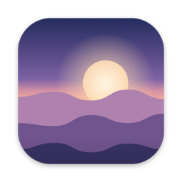
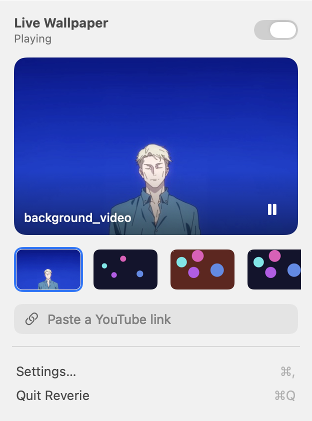
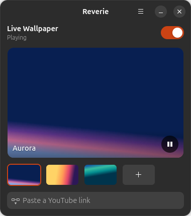
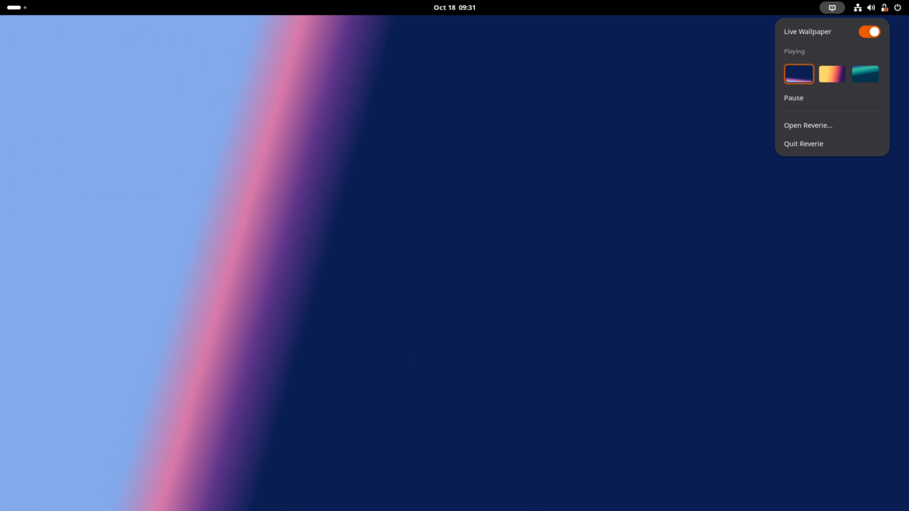

<p align="center">
  
</p>

<h1 align="center">Reverie</h1>

<p align="center">Live video wallpapers for macOS and Linux.</p>

<p align="center">
  
  
  <a href="LICENSE"></a>
</p>

<p align="center">
  A native menu bar app on the Mac, and a GTK app with a GNOME Shell extension on Linux.<br>
  Inspired by <a href="https://github.com/jeffshee/gnome-ext-hanabi">Hanabi</a>.
</p>

<table align="center">
  <tr>
    <th>macOS</th>
    <th>Linux</th>
  </tr>
  <tr>
    <td></td>
    <td></td>
  </tr>
</table>

## Features

- **Any video as your wallpaper.** It plays beneath your desktop icons on every display and never intercepts clicks. MP4 and MOV work everywhere; Linux also plays WebM and MKV.
- **YouTube links.** Paste a link and Reverie downloads a silent, hardware-friendly copy with [yt-dlp](https://github.com/yt-dlp/yt-dlp), installed on demand the first time you ask.
- **Smart pausing.** Reverie pauses when the wallpaper is hidden by full-screen or maximized windows, while the screen is locked or asleep, in Low Power or Power Saver mode, and optionally on battery.
- **Fill or Fit.** Fit shows the whole video and extends it to the screen edges with a soft blur instead of black bars.
- **Matching lock screen.** Reverie sets a still from your video as the real desktop picture, so the lock screen matches. Your original picture comes back when you turn Reverie off.
- **Light on resources.** One hardware decoder feeds every display. On an M2 that's about 1% CPU for 1080p; on Linux it costs about as much as playing the video in mpv.
- Crossfades between videos, a recent-videos strip, drag and drop, Open With → Reverie, Open at Login, and light and dark mode.

## Install

### macOS

Requires macOS 27 or later on Apple silicon, and Xcode or just the Command Line Tools (`xcode-select --install`).

```bash
git clone https://github.com/austxu/Reverie.git
cd Reverie/macos
./build.sh --install
```

This builds `build/Reverie.app` (ad-hoc signed), copies it to `/Applications`, and launches it. Run `./build.sh` alone to build without installing.

### Linux

Reverie runs on **GNOME 46–50** on Wayland (tested on 50) through its bundled Shell extension. On **wlroots compositors** (Sway, Hyprland, river, Wayfire, niri, labwc…) it uses [gtk4-layer-shell](https://github.com/wmww/gtk4-layer-shell). KDE Plasma draws its own background layer, so use a Plasma wallpaper plugin there.

First install the dependencies: Python 3.10+, PyGObject, GTK 4.14+, libadwaita 1.5+, libmpv 2, and gtk4-layer-shell outside GNOME.

```bash
# Ubuntu / Debian
sudo apt install python3-gi gir1.2-gtk-4.0 gir1.2-adw-1 libmpv2
# Fedora
sudo dnf install python3-gobject gtk4 libadwaita mpv-libs
# Arch
sudo pacman -S python-gobject gtk4 libadwaita mpv
```

Then install Reverie for your user (no root needed):

```bash
git clone https://github.com/austxu/Reverie.git
cd Reverie/linux
./install.sh
```

On GNOME, log out and back in once so the Shell finds the extension, then turn it on:

```bash
gnome-extensions enable reverie@austxu.github.io
```

If you used Hanabi, turn it off so the two don't draw over each other. For hardware decoding you need VA-API drivers: Intel and AMD ones ship with Mesa, and NVIDIA needs `nvidia-vaapi-driver`. `./install.sh --uninstall` removes everything except your library in `~/.local/share/reverie`.

<p align="center">
  
</p>

## Usage

1. Open Reverie: click its icon in the menu bar on macOS. On Linux, click its icon in the GNOME top bar, or open it from the app menu.
2. Click **+** (or **Choose a Video**), drag a video in, or use **Open With → Reverie** from your file manager. You can also paste a YouTube link.
3. Click a thumbnail to switch videos. Right-click one to show it in your file manager or remove it.
4. **Settings…** has scaling, sound, automatic pausing, desktop-picture matching, and Open at Login.

From a terminal: `open -a Reverie video.mov` on macOS, or `reverie video.mp4` on Linux (`reverie --background` starts it without the window).

**Tip:** for a perfect fit, use a video with the same shape as your display (for example 2560×1600 on a 16:10 MacBook) encoded as H.264 or HEVC.

## How it works

**macOS.** Reverie places a borderless, click-through window at the desktop window level on each screen, above the system wallpaper and below Finder's icons, and plays the video there with `AVPlayerLayer`. A single `AVQueuePlayer` + `AVPlayerLooper` feeds every screen, so the video is decoded once. Visibility comes from the window server's occlusion state.

**Linux.** libmpv decodes once (VA-API when available) and renders each frame on its own thread into an OpenGL texture shared with GTK, so frames never leave the GPU. GTK draws that texture in one window per monitor:
- On GNOME, the Shell extension keeps those windows minimized and out of the window lists, and shows a live clone of each inside the desktop, overview and lock screen backgrounds. It also tells the app when windows cover every monitor, so playback pauses.
- Elsewhere, the windows sit on the compositor's background layer.

Lock, suspend, display sleep, Power Saver and battery state come from logind, the screensaver interface, Mutter, power-profiles-daemon and UPower.

| Path | Role |
|---|---|
| `macos/Sources/Reverie/WallpaperEngine.swift` | Desktop-level windows, shared looping player, crossfades |
| `macos/Sources/Reverie/PauseMonitor.swift` | Lock, sleep, power, and visibility → pause reasons |
| `macos/Sources/Reverie/AppModel.swift` | App state, settings, library, desktop picture sync |
| `macos/Sources/Reverie/MenuView.swift`, `SettingsView.swift` | SwiftUI interface |
| `macos/tools/` | Icon and sample-video generators |
| `linux/reverie/mpv.py` | libmpv binding; renders frames into GL textures shared with GTK |
| `linux/reverie/engine.py` | Wallpaper windows, crossfades, recovery from stalls |
| `linux/reverie/model.py`, `pause.py` | App state, settings, library, pause reasons |
| `linux/reverie/window.py`, `app.py` | GTK interface and the D-Bus API the extension uses |
| `linux/gnome-extension/` | GNOME Shell extension: background clones, coverage, top bar menu |

## Development notes

**macOS** (run these from `macos/`)
- Use `@ViewState` rather than `@State` in views. In the macOS 27 SDK `@State` is a macro whose compiler plugin ships only with full Xcode. `ViewState` is a typealias to the same property wrapper, so the project also builds with just the Command Line Tools.
- Render the UI to PNGs (light and dark) without a screen-recording permission: `REVERIE_SNAPSHOT=/tmp/shots build/Reverie.app/Contents/MacOS/Reverie`
- Playback log: `/usr/bin/log show --last 5m --info --predicate 'process == "Reverie" AND category == "playback"'`
- Make a sample video: `swift tools/make_test_video.swift samples/test.mov`

**Linux**
- Run from the checkout: `cd linux && python3 -m reverie --verbose`
- Extension logs: `journalctl --user -f /usr/bin/gnome-shell`
- To test the extension without touching your session, run a headless nested Shell. Export `XDG_CONFIG_HOME` and `XDG_DATA_HOME` to a temporary directory *before* `dbus-run-session -- gnome-shell --headless --wayland --virtual-monitor 1920x1080`; otherwise its settings land in your real dconf database.

## Limitations

- macOS doesn't allow custom video on the lock screen, so Reverie shows a matching still there. The matching desktop picture applies to the current Space; the live video appears on all Spaces.
- On Linux, automatic pausing when windows cover the desktop needs the GNOME extension; on wlroots compositors Reverie still pauses on lock, sleep and power changes. On GNOME the video corners in the overview are square.
- Downloaded videos are for your personal use. Respect the terms of the sites you download from.

## License

[MIT](LICENSE)
